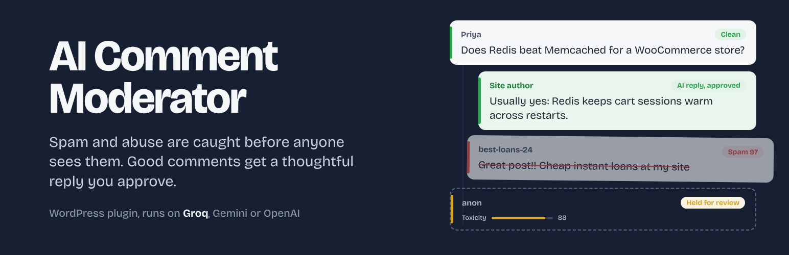
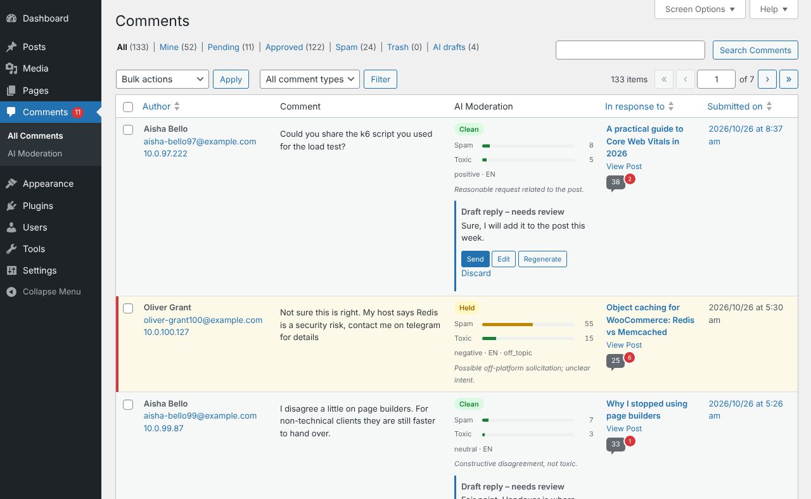
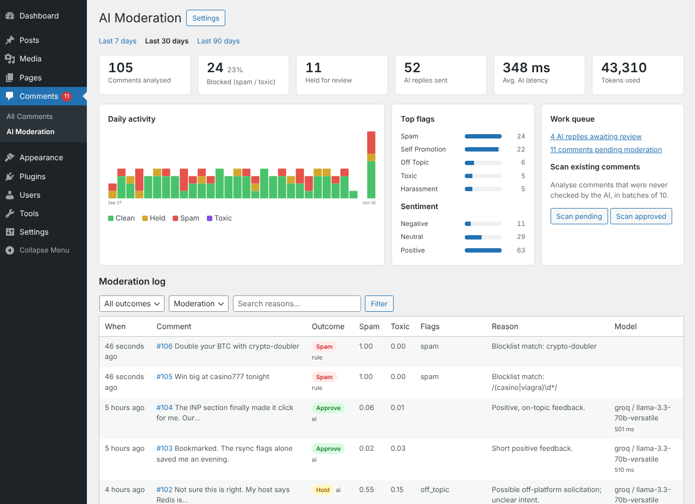
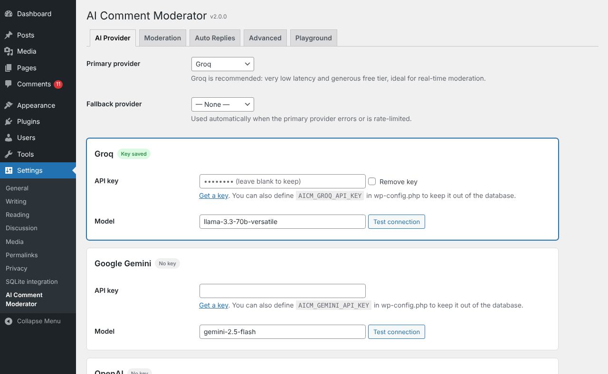
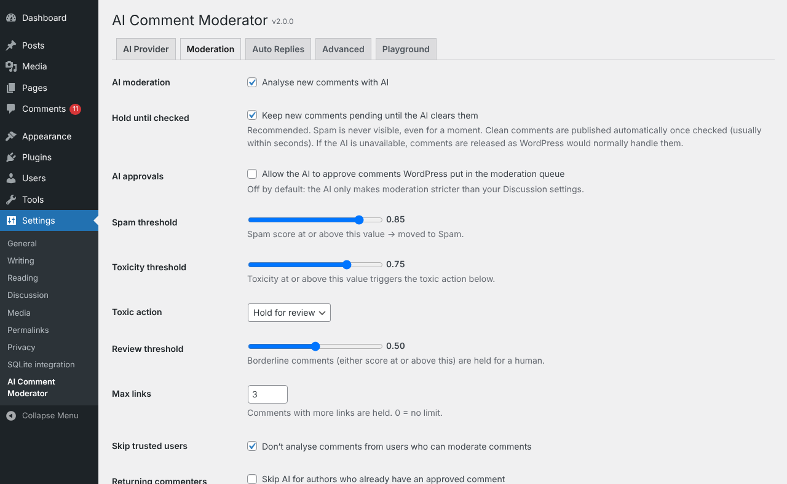
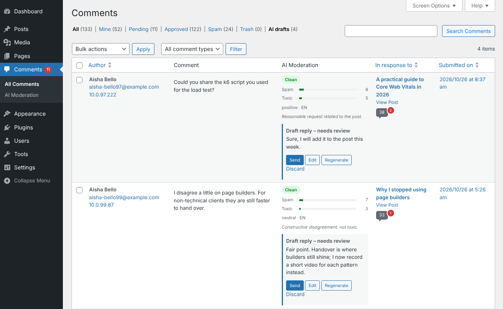

<p align="center">
  
</p>

<p align="center">
  <a href="https://github.com/rajanvijayan/ai-comment-moderator/releases"></a>
  
  
  
  <a href="LICENSE"></a>
</p>

# AI Comment Moderator

A WordPress plugin that reads every new comment with a fast LLM before it goes live. Spam goes to the spam folder, abuse is held for you, and genuine comments are published within seconds. When a comment deserves an answer, the plugin drafts a reply in context, and you approve it with one click.

Groq is the default provider because its latency suits real-time moderation. Google Gemini and OpenAI work too, and either can act as an automatic fallback.

<p align="center">
  
  <br><sub>Every comment gets a verdict, scores and a one-line reason. Draft replies wait for your approval right in the Comments screen.</sub>
</p>

## Contents

- [What it does](#what-it-does)
- [Screenshots](#screenshots)
- [Quick start](#quick-start)
- [How a comment is processed](#how-a-comment-is-processed)
- [WP-CLI](#wp-cli)
- [Developer hooks](#developer-hooks)
- [Upgrading from 1.x](#upgrading-from-1x)
- [Privacy](#privacy)
- [Development](#development)

## What it does

### Moderation
- **Two scores per comment**, spam and toxicity from 0 to 1, with thresholds you set. Borderline comments are held for a human instead of guessed at.
- **Hold until checked.** New comments stay pending until the AI clears them, so spam is never visible, even briefly. If the AI is unreachable, comments fall back to your normal Discussion settings.
- **Stricter, never looser.** By default the AI can only tighten moderation. Letting it approve comments WordPress held is an explicit opt-in.
- **Categories, sentiment and language** for each comment: spam, self-promotion, harassment, hate, off-topic, personal info and more.
- **Free pre-filters** that run before any API call: blocklist (words or regex), allow-list (emails or whole domains), a link limit, and skips for trusted users and returning commenters.
- **House rules in plain language**, such as "self-promotion of related open-source projects is fine", added to the prompt.
- **Injection-resistant prompts.** Comment text is passed as delimited data, and an optional pre-check uses Groq's Prompt Guard (a preview model).

### Replies
- **Context-aware drafts** that use the post title, excerpt and the parent comment, written in the commenter's language or your site's.
- **Human review by default**, with Send, Edit, Regenerate and Discard on each draft and an **AI drafts** filter in the Comments screen.
- **Guardrails:** a natural delay, a daily cap, a word limit, links and markdown stripped, no replies to negative comments if you prefer, and no replying to its own replies.

### Operations
- **Background processing** on WP-Cron, so submitting a comment stays instant. Failed calls retry with exponential backoff, and a safety sweep picks up anything stuck.
- **Provider fallback.** A Groq rate limit (HTTP 429) or outage switches to your second provider automatically.
- **Dashboard and audit log** with totals, block rate, latency, token usage, a daily chart, top flags and a searchable log.
- **Batch scan** of existing comments, from the dashboard or WP-CLI.
- **Playground** for trying your settings on any text without saving anything, plus a **Test connection** button per provider.
- **Email alerts** for toxic comments.
- **Keys in `wp-config.php`** if you'd rather not store them in the database.

## Screenshots

<table>
  <tr>
    <td width="50%"></td>
    <td width="50%"></td>
  </tr>
  <tr>
    <td><sub><b>Dashboard.</b> A month of moderation at a glance, with every decision logged alongside its reason and model.</sub></td>
    <td><sub><b>Providers.</b> Pick Groq, Gemini or OpenAI, set a fallback, and test the connection before saving.</sub></td>
  </tr>
  <tr>
    <td></td>
    <td></td>
  </tr>
  <tr>
    <td><sub><b>Moderation rules.</b> Thresholds, what to do with toxic comments, and which comments to skip.</sub></td>
    <td><sub><b>AI drafts.</b> One filter shows every reply waiting for your approval.</sub></td>
  </tr>
</table>

## Quick start

**Requirements:** WordPress 6.0+, PHP 7.4+, and an API key from [Groq](https://console.groq.com/keys) (recommended), [Google AI Studio](https://aistudio.google.com/app/apikey) or [OpenAI](https://platform.openai.com/api-keys).

1. Download `ai-comment-moderator.zip` from [Releases](https://github.com/rajanvijayan/ai-comment-moderator/releases). In WordPress, go to **Plugins → Add New → Upload Plugin**, then install and activate it.
2. Open **Settings → AI Comment Moderator**, paste your Groq key and click **Test connection**.
3. On the **Moderation** tab, turn on **Hold until checked**.
4. Optionally, on the **Auto Replies** tab, turn on replies and choose who they're posted as.
5. Try a few comments in the **Playground** tab, then watch **Comments → AI Moderation**.

To keep the key out of the database, define it in `wp-config.php` instead:

```php
define( 'AICM_GROQ_API_KEY', 'gsk_...' );
// Also supported: AICM_GEMINI_API_KEY, AICM_OPENAI_API_KEY
```

The plugin has no runtime Composer dependencies. Cloning the repository into `wp-content/plugins/` works as is, because a built-in autoloader is used when `vendor/` is absent.

## How a comment is processed

```
new comment ─► pre-filters (blocklist · allow-list · trusted users) ──► decided, no API call
                    │ no match
                    ▼
     held until checked ─► background job ─► Groq, JSON mode ──429 / 5xx──► fallback provider
                                                 │                               │
                                                 ▼                               ▼
                           thresholds ─► approve │ hold │ spam │ trash ─► audit log
                                                 │
                                                 ▼ approved and worth a reply
                           draft reply ─► your review ─► published as your reply author
```

If every provider fails after five attempts, the comment is released the way WordPress would have handled it, and the error is logged.

## WP-CLI

```bash
wp ai-moderator test                            # ping the configured providers
wp ai-moderator check 123 --dry-run             # show a verdict without acting on it
wp ai-moderator scan --status=hold --limit=500  # analyse comments never checked
wp ai-moderator stats --days=7 --format=json
```

## Developer hooks

| Hook | Type | Use it to |
| --- | --- | --- |
| `aicm_verdict` | filter | Change a verdict before it's applied |
| `aicm_classification_prompt` | filter | Add context or rules to the moderation prompt |
| `aicm_reply_prompt` | filter | Adjust how replies are written |
| `aicm_should_reply` | filter | Decide which comments get a reply |
| `aicm_reply_to_ai_thread` | filter | Allow replies in threads the AI already joined |
| `aicm_fail_open` | filter | Keep comments held when the AI is unavailable |
| `aicm_after_moderation` | action | React to any decision (Slack, analytics…) |
| `aicm_reply_sent` | action | React to a published reply |

```php
// Never auto-spam a partner's comments; hold them instead.
add_filter( 'aicm_verdict', function ( $verdict, $comment ) {
    if ( '@partner.com' === substr( $comment->comment_author_email, -12 ) && 'spam' === $verdict->action ) {
        $verdict->action = 'hold';
    }
    return $verdict;
}, 10, 2 );

// Only reply on tutorials.
add_filter( 'aicm_should_reply', function ( $ok, $comment ) {
    return $ok && has_category( 'tutorials', $comment->comment_post_ID );
}, 10, 2 );

// Fail closed on a high-risk site: keep comments pending if the AI is down.
add_filter( 'aicm_fail_open', '__return_false' );
```

## Upgrading from 1.x

Settings migrate automatically the first time 2.0 loads:

- The 1.x API key becomes your Gemini key and Gemini stays active, so nothing changes until you add a Groq key.
- If auto-response was on, it stays on with review off, matching 1.x behaviour.
- Replies that 1.x had queued but not sent become drafts awaiting your review.

2.0 also fixes several 1.x bugs: spam was never detected, spam comments received replies, replies had no author name, scheduled jobs survived deactivation, and a missing class was referenced. See the [changelog](CHANGELOG.md) for details.

## Privacy

To score a comment, the plugin sends the comment text, the commenter's name and URL, and the post title and excerpt to the AI provider you choose. Commenter emails and IP addresses are never sent. Mention the provider in your site's privacy policy.

## Development

- **CI** lints every PHP file on PHP 7.4, 8.1 and 8.3 for each push and pull request.
- **Releases:** bump `Version:` in `ai-comment-moderator.php`, then run the **Create Release** workflow with the same version. It builds the zip and publishes a GitHub release.
- **Artwork:** the banner, icon and screenshots live in [`.wordpress-org/`](.wordpress-org), using the WordPress.org asset sizes, and are left out of the plugin zip.

## License

[GPL-2.0-or-later](LICENSE)
